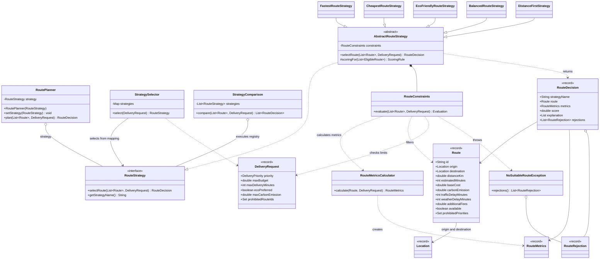
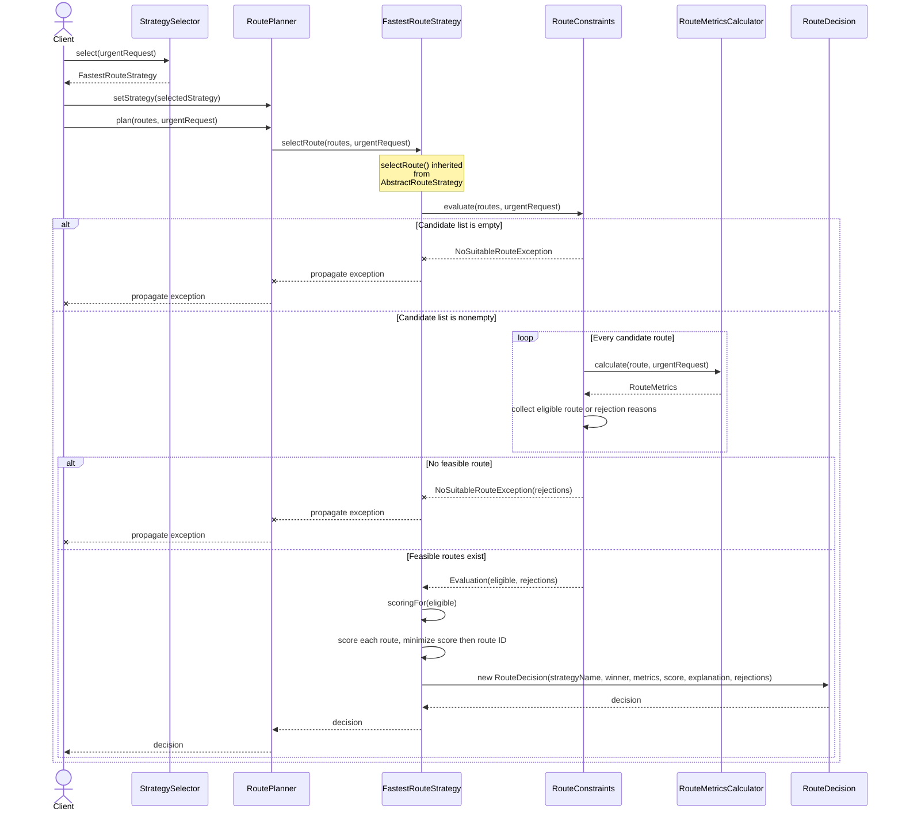

# Smart Delivery and Route Optimization Engine

Assignment 5: a Java 17 application demonstrating the **Strategy pattern**. It selects the fastest, cheapest, greenest, balanced, or shortest route from predefined candidates, checking hard constraints before scoring.

## Build and run

Requires JDK 17 or newer. The included Maven Wrapper downloads Maven 3.9.11 and dependencies on the first run.

```bash
./mvnw clean verify
java -jar target/smart-delivery.jar demo
```

On Windows, use `.\mvnw.cmd clean verify`. Run tests separately with `./mvnw test`.

| Mode | Purpose |
| --- | --- |
| `demo` (default) | Runtime switching, automatic selection, comparison, and failures |
| `compare` | Compare all five strategies on identical input |
| `failures` | Show empty candidates, infeasible requests, and invalid weights |
| `help` or `--help` | Print usage |

## Architecture

`RoutePlanner` is the context and delegates selection to the `RouteStrategy` interface. `setStrategy()` replaces the algorithm at runtime. `AbstractRouteStrategy` shares filtering, scoring, and deterministic selection; each concrete strategy supplies its scoring rule.

| Role | Implementation |
| --- | --- |
| Context | [`RoutePlanner`](src/main/java/kz/sdp/delivery/planning/RoutePlanner.java) |
| Strategy | [`RouteStrategy`](src/main/java/kz/sdp/delivery/strategy/RouteStrategy.java) |
| Concrete strategies | `FastestRouteStrategy`, `CheapestRouteStrategy`, `EcoFriendlyRouteStrategy`, `BalancedRouteStrategy`, `DistanceFirstStrategy` |
| Shared validation and selection | `AbstractRouteStrategy` |
| Algorithm selection by business rules | `StrategySelector` |
| Constraints and shared metrics | `RouteConstraints`, `RouteMetricsCalculator` |
| Algorithm comparison | `StrategyComparison` |
| Explainable result | `RouteDecision`, `RouteMetrics`, `RouteRejection` |

| Package | Responsibility |
| --- | --- |
| `domain` | Routes, requests, locations, and immutable results |
| `routing` | Hard constraints and shared metric calculation |
| `strategy` | Strategy interface and five algorithms |
| `planning` | Planner, automatic selector, and comparison |
| `app` | CLI, sample routes, and reporting |

`RouteDecision` includes the selected route, metrics, score, explanation, and rejected candidates with reasons.

## Algorithms and metrics

| Strategy | Minimizes |
| --- | --- |
| Fastest | Delivery time, including traffic and weather |
| Cheapest | Total delivery cost |
| Eco-friendly | `CO2 * emissionWeight + distance * distanceWeight` |
| Balanced | Weighted normalized time, cost, distance, and CO2 |
| Distance-first | Distance |

```text
deliveryMinutes = estimatedMinutes + trafficDelayMinutes + weatherDelayMinutes
totalCost = baseCost + distanceKm * 40 + prioritySurcharge + additionalFees
prioritySurcharge = 500 KZT for URGENT, otherwise 0
```

Eco defaults: emission weight `1.0`, distance weight `0.03`. Balanced defaults: time `0.40`, cost `0.30`, distance `0.10`, emissions `0.20`. Balanced normalizes each criterion using `(x - min) / (max - min)` across feasible candidates; constant criteria contribute zero. Weights must be finite and nonnegative; Balanced weights must sum to one within `1e-9`.

Lower scores win, with route ID breaking ties. Scores from different strategies are not directly comparable.

## Constraints and selection

Candidates must be available, within budget, deadline, and emission limits, and allowed by both request and priority restrictions. Limits are inclusive. Route IDs must be unique, and all routes must share endpoints. Invalid input is rejected; empty or entirely infeasible candidates raise `NoSuitableRouteException`.

`StrategySelector` uses the following default mapping:

| Priority | Default strategy |
| --- | --- |
| URGENT | Fastest |
| ECONOMY | Cheapest |
| ECO | Eco-friendly |
| STANDARD | Balanced |

An eco preference overrides nonurgent priorities; urgent deliveries retain Fastest.

Add an algorithm by implementing `RouteStrategy` or extending `AbstractRouteStrategy`, then register it for comparison or automatic selection. `RoutePlanner` requires no changes. This supports SRP, OCP, and DIP through separate responsibilities and interface-based delegation.

## Verification and documentation

**62 JUnit tests pass**, covering validation, formulas, constraints, normalization, ties, runtime switching, and automatic selection.

| Test suite | Tests | Main checks |
| --- | ---: | --- |
| `DomainValidationTest` | 9 | Invalid numbers, coordinates, required data, defensive copies |
| `StrategyAlgorithmsTest` | 23 | Five algorithms, formulas, custom weights, normalization, ties, invalid weights |
| `HardConstraintsTest` | 20 | Constraints across strategies, budget, deadline, infeasible routes, boundaries, time overflow |
| `PlanningIntegrationTest` | 10 | Three runtime switches, request-based selection, rule precedence, custom mappings, comparison |

- [Class diagram](docs/class-diagram.mmd)
- [Sequence diagram](docs/sequence-diagram.mmd)
- [Demo output](docs/console-output.txt)
- [Saved test results](docs/test-results.txt)

The demo uses eight synthetic routes between an Almaty depot and hospital. The application selects existing routes; it does not calculate road paths or allocate vehicles. Prices and delays are fixed inputs. Financial production use would require decimal arithmetic and explicit rounding rules.

## UML class diagram



## UML sequence diagram


