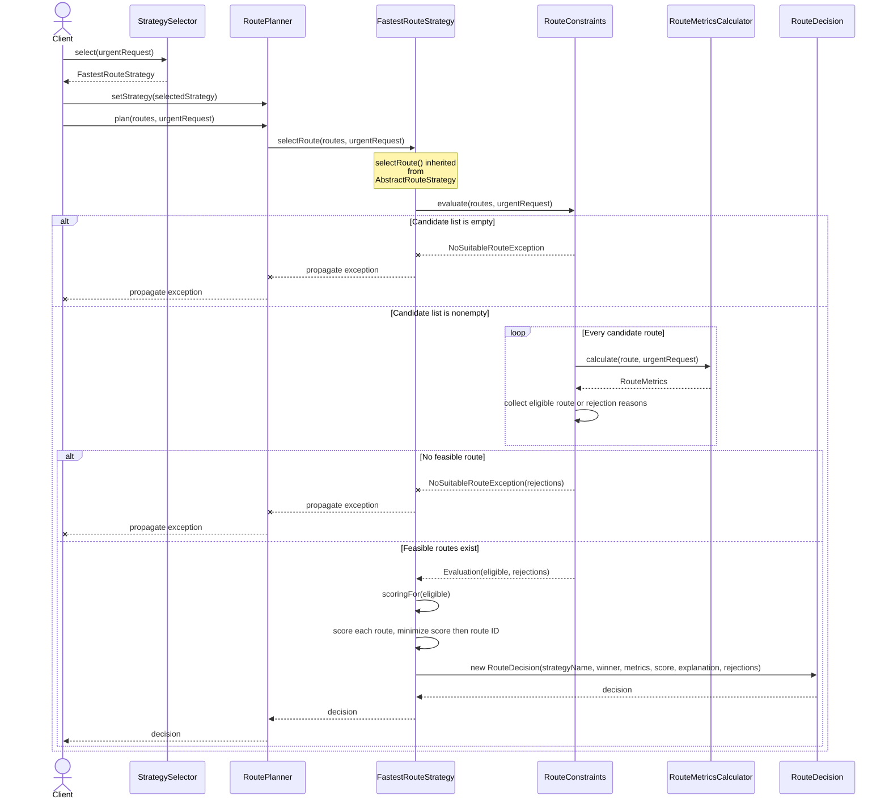

# Smart Delivery and Route Optimization Engine

Assignment 5: система выбора маршрута доставки на Java 17 с паттерном Strategy. Один запрос можно обработать разными алгоритмами: выбрать самый быстрый, дешёвый, экологичный, сбалансированный или короткий маршрут. Жёсткие ограничения проверяются до оценки кандидатов.

## Сборка и запуск

Нужен JDK 17 или новее. Maven устанавливать отдельно не требуется: включён [официальный Maven Wrapper](https://maven.apache.org/tools/wrapper/) с закреплённой версией Maven 3.9.11 и SHA-256 дистрибутива. Первый запуск требует доступа к Maven Central для загрузки Maven и зависимостей.

Linux/macOS:

```bash
./mvnw clean verify
java -jar target/smart-delivery.jar demo
```

Windows PowerShell:

```powershell
.\mvnw.cmd clean verify
java -jar target/smart-delivery.jar demo
```

Режимы приложения:

| Команда после `java -jar target/smart-delivery.jar` | Что показывает |
| --- | --- |
| `demo` или без аргументов | Полную демонстрацию, включая переключения, выбор по запросу, сравнение и ошибки |
| `compare` | Все пять стратегий на одном запросе и одинаковых маршрутах |
| `failures` | Пустой список, отсутствие допустимого маршрута, некорректные веса |
| `help` или `--help` | Справку |

Неизвестная команда завершает приложение с кодом `2`. Только тесты можно запустить через `./mvnw test`.

## Архитектура и Strategy

Проблема, которую решает Strategy: алгоритмы выбора маршрута меняются независимо от кода планировщика. `RoutePlanner` хранит `RouteStrategy`: его метод `plan()` делегирует выбор вызову `strategy.selectRoute()`. В контексте нет ветвлений по имени или конкретному классу стратегии. Новый алгоритм реализует тот же контракт и может быть установлен во время работы.

| Роль | Реализация |
| --- | --- |
| Context | [`RoutePlanner`](src/main/java/kz/sdp/delivery/planning/RoutePlanner.java) |
| Strategy | [`RouteStrategy`](src/main/java/kz/sdp/delivery/strategy/RouteStrategy.java) |
| Concrete Strategies | `FastestRouteStrategy`, `CheapestRouteStrategy`, `EcoFriendlyRouteStrategy`, `BalancedRouteStrategy`, `DistanceFirstStrategy` |
| Общая последовательность проверки и выбора | `AbstractRouteStrategy` |
| Выбор алгоритма по бизнес-условиям | `StrategySelector` |
| Ограничения и единые метрики | `RouteConstraints`, `RouteMetricsCalculator` |
| Сравнение алгоритмов | `StrategyComparison` |
| Объяснимый результат | `RouteDecision`, `RouteMetrics`, `RouteRejection` |

```text
src/main/java/kz/sdp/delivery/
  domain/       Location, Route, DeliveryRequest, DeliveryPriority, результаты
  routing/      ограничения, расчёт метрик, NoSuitableRouteException
  strategy/     интерфейс, общая процедура выбора, пять алгоритмов
  planning/     контекст, автоматический выбор, сравнение
  app/          точка входа, восемь маршрутов, консольный вывод
src/test/java/kz/sdp/delivery/
  DomainValidationTest, StrategyAlgorithmsTest,
  HardConstraintsTest, PlanningIntegrationTest, TestRoutes
```

Интерфейс возвращает `RouteDecision` вместо одного `Route`. Это разрешённое расширение примера из задания: вместе с маршрутом возвращаются итоговые метрики, оценка, объяснение алгоритма и причины отклонения недопустимых кандидатов. Модель результата неизменяема; списки и наборы копируются.

`AbstractRouteStrategy` повторно использует фильтрацию, выбор минимальной оценки и разрешение равенств. Конкретная стратегия задаёт собственное правило оценки через `scoringFor()`. Такой внутренний шаблон не меняет роль Strategy: `RoutePlanner` по-прежнему зависит только от `RouteStrategy`.

## Формулы и единицы измерения

Расстояние задаётся в километрах, время — в минутах, стоимость — в тенге (KZT), выбросы — в килограммах CO2. Все стратегии используют одинаковые итоговые время и стоимость из `RouteMetricsCalculator`:

```text
deliveryMinutes = estimatedMinutes + trafficDelayMinutes + weatherDelayMinutes

totalCost = baseCost + distanceKm * 40 + prioritySurcharge + additionalFees
prioritySurcharge = 500 для URGENT, иначе 0
```

Например, маршрут длиной 2 км с базовой ценой 1000 KZT, сборами 75 KZT и срочным запросом стоит `1000 + 2 * 40 + 500 + 75 = 1655 KZT`. Стоимость рассчитывается единым компонентом, чтобы проверка бюджета и сравнение маршрутов не расходились.

| Стратегия | Минимизируемая величина |
| --- | --- |
| Fastest | Итоговое время с пробками и погодой |
| Cheapest | Полная стоимость с расстоянием, срочностью и сборами |
| Eco-friendly | `carbonEmission * emissionWeight + distanceKm * distanceWeight` |
| Balanced | Взвешенная сумма четырёх нормализованных критериев |
| Distance-first | Расстояние среди допустимых маршрутов |

Eco по умолчанию использует веса `1.0` для CO2 и `0.03` для расстояния. Это условная оценка воздействия, а не измерение дополнительных физических выбросов. Формула принадлежит экологической стратегии, поскольку именно она определяет, как сопоставлять эти критерии. Оба веса настраиваются, должны быть конечными и неотрицательными, хотя бы один — положительным.

Balanced по умолчанию использует веса времени `0.40`, стоимости `0.30`, расстояния `0.10`, выбросов `0.20`:

```text
normalized(x) = (x - min(x)) / (max(x) - min(x))
score = normalizedTime * timeWeight
      + normalizedCost * costWeight
      + normalizedDistance * distanceWeight
      + normalizedEmission * emissionWeight
```

Минимум и максимум вычисляются только по допустимым маршрутам текущего запроса. При одинаковых значениях критерия его нормализованное значение равно `0`, поэтому деления на ноль нет. Все веса должны быть конечными, неотрицательными и давать сумму `1.0` с допуском `1e-9`. Принятые веса дополнительно делятся на их сумму. Ошибочная конфигурация вызывает `IllegalArgumentException`.

```java
var strategy = new BalancedRouteStrategy(0.40, 0.30, 0.10, 0.20);
```

Во всех стратегиях меньшая оценка лучше; при равенстве побеждает лексикографически меньший ID маршрута. Оценки разных стратегий имеют разные единицы и смысл: сравнивать число `28` у Fastest с `0.2794` у Balanced нельзя.

## Запросы и ограничения

`DeliveryRequest` содержит приоритет, бюджет, срок, экологическое предпочтение, лимит выбросов и запрещённые ID маршрутов. Короткий конструктор из четырёх аргументов задаёт отсутствие дополнительного лимита выбросов через `Double.MAX_VALUE` и пустой набор запрещённых ID.

До оценки маршрута проверяются:

- доступность;
- полная стоимость не выше бюджета;
- итоговое время не больше срока;
- отсутствие запрета для приоритета доставки;
- отсутствие ID в запретах запроса;
- выбросы не выше установленного лимита.

Равенство бюджету, сроку и лимиту выбросов допустимо. Для отклонённого маршрута сохраняются все найденные причины. Пустой список и отсутствие допустимых кандидатов вызывают `NoSuitableRouteException`; во втором случае исключение содержит отклонения. `null` вместо результата не возвращается.

Метрики маршрутов и числовые лимиты запроса должны быть конечными и неотрицательными. Доменная модель также отклоняет пустые имена/ID, неположительное время, отрицательные задержки и недопустимые координаты. Перед планированием проверяются уникальность ID и одинаковые начальная и конечная точки всех маршрутов. Отсутствующие обязательные объекты отклоняются явно. Сумма времени считается в `long`, чтобы избежать переполнения `int`.

## Автоматический выбор и переключение

`StrategySelector` решает, **какую** стратегию использовать, а стратегия — **как** выбрать маршрут. Расширяемое сопоставление хранится в `Map<DeliveryPriority, RouteStrategy>` и может передаваться через конструктор:

| Приоритет | Стратегия по умолчанию |
| --- | --- |
| URGENT | Fastest |
| ECONOMY | Cheapest |
| ECO | Eco-friendly |
| STANDARD | Balanced |

Правило приоритетов задано явно: `URGENT` сохраняет Fastest даже при `ecoPreferred=true`; для остальных приоритетов экологическое предпочтение выбирает значение `ECO` из карты. Таким образом, срочность медицинской доставки выше мягкого предпочтения, но экологический лимит остаётся жёстким ограничением.

Три последовательных вызова `setStrategy()` на одном объекте показаны в [`DeliveryApplication.runtimeSwitching()`](src/main/java/kz/sdp/delivery/app/DeliveryApplication.java) и проверяются тестом `onePlannerSwitchesAlgorithmsAtRuntimeThreeTimes`: Fastest → Cheapest → Eco-friendly → Balanced. В `automaticSelection()` объект `RoutePlanner` получает выбранную селектором стратегию, а `dynamicConstraints()` показывает смену результата Fastest при изменении бюджета с 6000 до 3000 KZT: R1-Express → R5-Avenue.

## Демонстрационные результаты

`DemoData` содержит восемь синтетических маршрутов между складом и больницей в Алматы. R7-Tunnel закрыт; R8-Freight запрещён для срочной доставки. У остальных различаются время, стоимость, расстояние и выбросы.

Реальный вывод `compare` для STANDARD, бюджета 6000 KZT и срока 90 минут:

```text
Fastest -> R1-Express | time 28 min | cost 4270.00 KZT | distance 18.00 km | CO2 4.80 kg | score 28.0000
Cheapest -> R4-Economy | time 50 min | cost 1710.00 KZT | distance 24.00 km | CO2 3.20 kg | score 1710.0000
Eco-friendly -> R3-Electric | time 42 min | cost 2700.00 KZT | distance 15.00 km | CO2 0.60 kg | score 1.0500
Balanced -> R5-Avenue | time 34 min | cost 2440.00 KZT | distance 16.00 km | CO2 1.40 kg | score 0.2794
Distance-first -> R6-Local | time 36 min | cost 2510.00 KZT | distance 9.00 km | CO2 2.50 kg | score 9.0000
```

Пример объяснения:

```text
Reason: Base time 25 + traffic 2 + weather 1 = 28 min
Rejected R7-Tunnel: Route is unavailable
```

Полный запуск с объяснениями, автоматическим выбором и тремя обработанными ошибками сохранён в [`docs/console-output.txt`](docs/console-output.txt).

## UML классов

Исходник: [`docs/class-diagram.mmd`](docs/class-diagram.mmd). На диаграмме опущены вспомогательные поля некоторых записей, но показаны все роли паттерна и связи планирования.


## UML последовательности

Исходник: [`docs/sequence-diagram.mmd`](docs/sequence-diagram.mmd). Сценарий соответствует `automaticSelection()` для срочного запроса; метод `selectRoute()` унаследован от `AbstractRouteStrategy`.



## Расширение и SOLID

Чтобы добавить алгоритм, нужно реализовать `RouteStrategy` либо унаследовать `AbstractRouteStrategy` и определить `getStrategyName()` и `scoringFor()`. Для включения в сравнение достаточно зарегистрировать экземпляр в `DeliveryApplication.availableStrategies()`. Для автоматического выбора можно передать свою карту в `StrategySelector`; изменения `RoutePlanner` не нужны.

Пятая стратегия `DistanceFirstStrategy` добавлена отдельным коммитом `ad46340` после рабочей версии с четырьмя алгоритмами. Из существующих классов изменился только `DeliveryApplication`: добавлены импорт и регистрация. Контекст, интерфейс, селектор и предыдущие стратегии не изменялись.

- **SRP:** планировщик делегирует, стратегии оценивают, селектор выбирает алгоритм, ограничения проверяются отдельно, консольный вывод вынесен в `ConsoleReporter`.
- **OCP:** новая стратегия подключается через общий контракт; существующий алгоритм планирования не переписывается.
- **DIP:** поле и конструктор `RoutePlanner` используют `RouteStrategy`, а не конкретные классы.

Это Strategy, а не просто `if/else`: каждое правило выбора находится в отдельном взаимозаменяемом объекте, и контекст не знает его формулу. Условия в селекторе относятся к бизнес-политике выбора алгоритма и не содержат сами алгоритмы.

**Отличие от Bridge:** Strategy представляет взаимозаменяемые способы решения одной задачи — выбора маршрута. Bridge разделяет две независимо развивающиеся иерархии абстракции и реализации, например управление доставкой и транспортный провайдер. Здесь требуется смена алгоритма внутри одного контекста; две независимые иерархии для этого не нужны.

## Тесты

Используется [JUnit 5.13.4](https://docs.junit.org/5.13.4/user-guide/). Проверенная сборка `clean verify`: **62 теста, 0 ошибок, 0 падений, 0 пропусков**. Параметризованные варианты считаются отдельными запусками.

| Набор | Запусков | Основные проверки |
| --- | ---: | --- |
| `DomainValidationTest` | 9 | Отрицательные/нечисловые значения, координаты, обязательные данные, копирование наборов |
| `StrategyAlgorithmsTest` | 23 | Все пять алгоритмов, формулы, смена весов, нормализация, равенства, неверные веса |
| `HardConstraintsTest` | 20 | Все ограничения для всех стратегий, бюджет, срок, отсутствие маршрута, границы, переполнение времени |
| `PlanningIntegrationTest` | 10 | Три переключения, выбор по запросу, приоритет правил, расширение карты, сравнение алгоритмов |

Проверяется конкретный выбранный маршрут или независимо рассчитанная оценка, а не только наличие объекта. Тесты также доказывают, что отклонённый экстремальный маршрут не искажает нормализацию Balanced и что одинаковые пределы бюджета/срока/выбросов разрешены. Сборка и запуск проверены на JDK 17.0.18; сохранённый результат — [`docs/test-results.txt`](docs/test-results.txt). Maven сохраняет подробные отчёты в `target/surefire-reports/`.

## Ограничения текущей архитектуры

Программа выбирает из готовых маршрутов с одинаковыми конечными точками; она не строит путь по дорожному графу и не распределяет несколько заказов между машинами. Тарифы фиксированы, а задержки и выбросы заданы входными данными без внешнего сервиса. Для финансового учёта `double` следует заменить на `BigDecimal` и определить правила округления. Изменяемый `RoutePlanner` рассчитан на последовательное использование, а не совместные конкурентные переключения. Нормализованные оценки Balanced зависят от набора допустимых кандидатов текущего запроса. Набор бизнес-приоритетов задан перечислением `DeliveryPriority`: новый приоритет требует расширить перечисление и карту селектора, хотя новый алгоритм можно подключить к существующему приоритету без этих изменений.

## История разработки и сдача

Работа разделена на 12 осмысленных коммитов с префиксом `Added`. Историю можно проверить через `git log --reverse --oneline`:

1. `Added reproducible Java 17 Maven project setup`
2. `Added validated delivery requests routes and locations`
3. `Added strategy contract explainable decisions and hard constraints`
4. `Added fastest route strategy with traffic and weather delays`
5. `Added cheapest route strategy with transparent total pricing`
6. `Added eco friendly strategy with configurable impact scoring`
7. `Added balanced strategy with validated normalized weights`
8. `Added runtime strategy switching and automatic strategy selection`
9. `Added executable delivery demo comparison mode and failure scenarios`
10. `Added fifth distance first strategy without changing the planner`
11. `Added comprehensive JUnit 5 routing and validation tests`
12. `Added UML diagrams README and verified delivery examples`

README служит отчётом по заданию: здесь приведены архитектура, UML, формулы, примеры вывода, результаты тестов и ограничения. Для сдачи нужно опубликовать репозиторий на GitHub с публичным доступом и передать ссылку и отчёт через Moodle. Локальная история коммитов сама по себе не подтверждает публикацию или сдачу.
